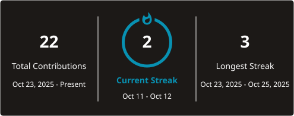

<!-- This README.md is based on README from @Pratham31 (https://github.com/Pratham31) and @Psotob (https://github.com/psotob) -->

<h2>{Hola mundo} </h2>

## It's Anthony here!

I'm Anthony Romero-Cerdán, a physician graduated from the Universidad Nacional Mayor de San Marcos (Peru). I work at the intersection of medicine and data: I use R and Stata for health data science, biostatistics, and clinical and public health epidemiology (yes, I'm a bit of a geek). I'm a continuous learner who enjoys building small projects and experimenting with new tools.

- 🔭 Currently: doing my rural health service (SERUMS) in Huánuco, Peru.
- 📊 I provide statistical analysis consulting in R for health research projects and medical theses.
- 🌱 Always sharpening my skills in R, Stata, Quarto and Shiny.
- 🤝 Open to collaborating on health data science and epidemiology projects.
- 💬 Ask me about: R for health data science, biostatistics and public health research.
- ⚡ Fun fact: I mix epidemiology and code the way others mix coffee and milk: daily, with passion.
- 🎯 Goal: to make data speak, especially when it can improve lives in healthcare.

## 📝 My website

On [**anthonyromero.netlify.app**](https://anthonyromero.netlify.app/) (built with R and Quarto, in English and Spanish) I share **tutorials**, **resources** and **news** about R, RStudio and data science applied to health research.

- 📌 Featured post: [Manual de instalación de R, RStudio y Rtools](https://anthonyromero.netlify.app/posts/Manual/)
- 👤 About me and CV: [anthonyromero.netlify.app/about](https://anthonyromero.netlify.app/about.html)
- 💻 Source code: [ganthonyr19/myblog](https://github.com/ganthonyr19/myblog)

## 🌐 Contact me

## ✍️ Scientific profile

As a researcher, I take part in research and data science projects and publish in peer-reviewed journals. You can find my work on:

## 🔧 Skills

**Data analysis**

**Version control**

**Web**

**References**

## 📈 GitHub stats

<!-- Generated daily by .github/workflows/profile-stats.yml -->

---

Thanks for stopping by! 😄

<!-- Resources -->
<!-- Icons: https://simpleicons.org/ -->
<!-- Badges: https://shields.io/ -->
<!-- GitHub Stats Action: https://github.com/stats-organization/github-readme-stats-action -->
<!-- Streak Stats: https://github.com/DenverCoder1/github-readme-streak-stats -->
<!-- Awesome GitHub Profile README: https://github.com/kautukkundan/Awesome-Profile-README-templates -->
